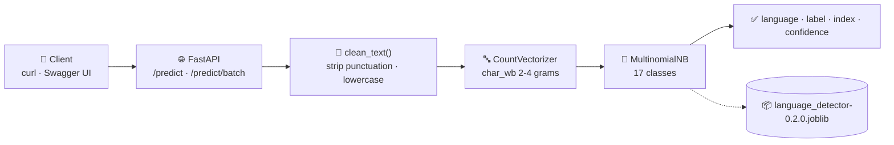

<div align="center">

# 🌍 Language Detection API

**A production-ready language-detection REST API.**
**scikit-learn Naive Bayes + FastAPI + Docker, deployed on Render and Azure.**

[](https://www.python.org/)
[](https://fastapi.tiangolo.com/)
[](https://scikit-learn.org/)
[](https://www.docker.com/)
[](https://render.com/)
[](https://azure.microsoft.com/)
[](https://github.com/Manohargov/Language-Detection-Docker_FastAPI_Render/actions/workflows/ci.yml)
[](LICENSE)

[🚀 Quick Start](#quick-start) · [📡 API](#api-reference) · [📊 Model Card](#model-card) · [🐳 Docker](#docker) · [☁️ Deploy](#deployment) · [🛠 Troubleshooting](#troubleshooting)

</div>

<details>
<summary><b>📑 Table of Contents</b></summary>

- [📖 What This Is](#what-this-is)
- [✨ Highlights](#highlights)
- [🏗 Architecture](#architecture)
- [📊 Model Card](#model-card)
- [🚀 Quick Start](#quick-start)
- [📡 API Reference](#api-reference)
- [🗂 Project Structure](#project-structure)
- [🧠 Retraining the Model](#training)
- [🐳 Docker](#docker)
- [☁️ Deployment](#deployment)
- [⚙️ Configuration](#configuration)
- [✅ Testing & CI](#testing)
- [🛠 Troubleshooting](#troubleshooting)
- [📋 Changelog](#changelog)
- [🤝 Contributing](#contributing)
- [📄 License](#license)
- [🙏 Acknowledgements](#acknowledgements)

</details>

<div align="center">

### `POST /predict`

```json
{ "text": "Ciao, come stai?" }
```

```json
{ "language": "Italian", "label": "Italian", "index": 8, "confidence": 1.0 }
```

</div>

---

<a id="what-this-is"></a>

## 📖 What This Is

A **complete, deployable language-detection service** — not just a notebook.

- **Model** — `CountVectorizer(char_wb 2-4)` → `MultinomialNB`, trained on 10,337 labelled samples across **17 languages**, reaching **98.98% accuracy**.
- **API** — FastAPI with automatic OpenAPI docs, request validation and typed responses.
- **Artifact** — a single self-describing `.joblib` bundle (pipeline + labels + metrics) — no hard-coded label lists to drift out of sync.
- **Container** — a slim, non-root, health-checked Docker image built on `python:3.12-slim`.
- **Deploy** — one-click on **Render** (blueprint included) or **Azure App Service** (GitHub Actions workflow included).
- **CI** — lint, format check, unit tests and a live container smoke test on every push.

---

<a id="highlights"></a>

## ✨ Highlights

| | Feature | Detail |
|---|---|---|
| 🎯 | **98.98% accuracy** | Character n-grams beat word unigrams — see [Model Card](#model-card) |
| 🧠 | **Self-describing artifact** | Pipeline, class labels and training metadata bundled in one `.joblib` |
| 🌐 | **FastAPI + OpenAPI** | Interactive Swagger UI at `/docs`, ReDoc at `/redoc` |
| ⚡ | **Batch endpoint** | Classify up to 100 texts in a single round-trip |
| 📊 | **Confidence scores** | Every prediction returns the max class probability |
| 🐳 | **Modern container** | `python:3.12-slim`, non-root user, `HEALTHCHECK`, layered cache |
| 🔁 | **Reproducible training** | `python model/prebuild/train.py` rebuilds the artifact from the dataset |
| ✅ | **23 tests + CI** | Pytest suite, Ruff lint, container smoke test on every push |
| 🔒 | **Safe by default** | `.dockerignore` keeps secrets and VCS data out of the image |

---

<a id="architecture"></a>

## 🏗 Architecture



**Request path**

1. **`main.py`** validates the body with Pydantic (`text`, 1–10,000 chars).
2. **`model/preprocessing.py`** strips punctuation/digits/brackets and lowercases — *the exact same function used at training time*.
3. **`model/model.py`** loads the artifact once at import, then runs `pipeline.predict()`.
4. The response carries the detected language, the raw dataset label, the class index and a confidence score.

---

<a id="model-card"></a>

## 📊 Model Card

### Architecture

| Component | Choice |
|---|---|
| Vectorizer | `CountVectorizer(analyzer="char_wb", ngram_range=(2, 4))` |
| Classifier | `MultinomialNB` |
| Preprocessing | strip `!@#$(),\n"%^*?:;~\`0-9[]` → lowercase |
| Split | 80 / 20, **stratified**, `random_state=42` |
| Artifact | `model/language_detector-0.2.0.joblib` (1.70 MB, compressed) |
| scikit-learn | `1.7.2` |

### Dataset

| | |
|---|---|
| Source | [Kaggle — Language Detection](https://www.kaggle.com/datasets/basilb2s/language-detection) |
| Rows | 10,337 |
| Classes | 17 |
| Split | 8,269 train / 2,068 test |
| Imbalance | English 1,385 → Hindi 63 samples per class |

### Metrics

| Metric | Score |
|---|---|
| **Accuracy** | **0.9898** |
| **F1 (weighted)** | **0.9898** |
| **F1 (macro)** | **0.9916** |

<details>
<summary><b>Per-class breakdown</b></summary>

| Language | Precision | Recall | F1 | Support |
|---|:---:|:---:|:---:|---:|
| Arabic | 1.00 | 1.00 | 1.00 | 107 |
| Danish | 1.00 | 0.94 | 0.97 | 86 |
| Dutch | 0.98 | 0.96 | 0.97 | 109 |
| English | 0.96 | 1.00 | 0.98 | 277 |
| French | 0.99 | 0.99 | 0.99 | 203 |
| German | 1.00 | 0.98 | 0.99 | 94 |
| Greek | 1.00 | 1.00 | 1.00 | 73 |
| Hindi | 1.00 | 1.00 | 1.00 | 12 |
| Italian | 0.99 | 1.00 | 1.00 | 140 |
| Kannada | 1.00 | 1.00 | 1.00 | 74 |
| Malayalam | 1.00 | 1.00 | 1.00 | 119 |
| Portuguese | 0.99 | 0.99 | 0.99 | 148 |
| Russian | 1.00 | 0.99 | 0.99 | 138 |
| Spanish | 0.99 | 0.99 | 0.99 | 164 |
| Swedish | 0.99 | 0.99 | 0.99 | 135 |
| Tamil | 1.00 | 1.00 | 1.00 | 94 |
| Turkish | 1.00 | 0.99 | 0.99 | 95 |

</details>

### Why character n-grams?

The original model used word unigrams (`CountVectorizer()`). That works fine for
space-delimited languages but fails on scripts that do not separate words with
spaces — a Hindi sentence collapses into a single token and the model falls back
to guessing:

| Input | v0.1.0 (word BoW) | v0.2.0 (char n-grams) |
|---|:---:|:---:|
| `"नमस्ते दोस्तों"` | ❌ English | ✅ **Hindi** |
| `"मैं ठीक हूँ धन्यवाद"` | ✅ Hindi | ✅ **Hindi** |
| Accuracy on the test split | 97.63% | **98.98%** |

Switching to `char_wb` 2-4 grams gained **+1.35 accuracy points** and fixed the Indic-script failures.

### Known limitations

- **17 languages only.** Chinese, Japanese, Korean and Thai are *not* in the training set and will be misclassified.
- **Short strings are unreliable — always check `confidence`.** A single Russian word is not enough signal:

  ```json
  { "text": "Привет" }
  → { "language": "English", "label": "English", "index": 3, "confidence": 0.134 }
  ```

  The same word inside a sentence is detected correctly with near-certainty. Treat low-confidence results as "unknown", not as a wrong answer.
- **Hindi is under-represented** (63 training samples vs 1,385 English), so its *test* score is based on just 12 samples.
- **Dataset label typos.** The source dataset spells two labels `Portugeese` and `Sweedish`. The API returns the corrected `Portuguese` / `Swedish`; the raw label is still available in the `label` field.
- **Domain shift.** The model is trained on Wikipedia-style sentences. Slang, code-switching and marketing copy will score lower.

---

<a id="quick-start"></a>

## 🚀 Quick Start

### 1️⃣ Clone and install

```bash
git clone https://github.com/Manohargov/Language-Detection-Docker_FastAPI_Render.git
cd Language-Detection-Docker_FastAPI_Render

python -m venv .venv
source .venv/bin/activate          # Windows: .venv\Scripts\activate

pip install -r requirements-dev.txt
```

> `requirements.txt` holds the runtime deps; `requirements-dev.txt` adds pytest + Ruff.

### 2️⃣ Run the API

```bash
uvicorn main:app --reload --port 8000
```

Open **<http://127.0.0.1:8000/docs>** for the interactive Swagger UI.

### 3️⃣ Try it

```bash
curl -X POST http://127.0.0.1:8000/predict \
  -H "Content-Type: application/json" \
  -d '{"text": "Ciao, come stai?"}'
```

```json
{"language":"Italian","label":"Italian","index":8,"confidence":1.0}
```

---

<a id="api-reference"></a>

## 📡 API Reference

| Method | Path | Purpose |
|---|---|---|
| `GET` | `/` | Health check, model version, supported languages, metrics |
| `GET` | `/health` | Same as `/` (alias — used by Docker `HEALTHCHECK` and Render) |
| `POST` | `/predict` | Detect the language of one text |
| `POST` | `/predict/batch` | Detect the language of up to 100 texts |
| `GET` | `/openapi.json` | OpenAPI schema |
| `GET` | `/docs` | Swagger UI |
| `GET` | `/redoc` | ReDoc |

### `POST /predict`

**Request**

```json
{ "text": "Bonjour tout le monde" }
```

**Response `200`**

```json
{
  "language": "French",
  "label": "French",
  "index": 4,
  "confidence": 1.0
}
```

| Field | Type | Meaning |
|---|---|---|
| `language` | string | Detected language, correctly spelled |
| `label` | string | Raw dataset label (differs only for `Portuguese` / `Swedish`) |
| `index` | int | Class index into the model's 17 classes |
| `confidence` | float | Max class probability, `0.0`–`1.0` |

**Errors** — `422` when `text` is missing, empty, whitespace-only or longer than 10,000 characters.

### `POST /predict/batch`

```bash
curl -X POST http://127.0.0.1:8000/predict/batch \
  -H "Content-Type: application/json" \
  -d '{"texts": ["Hello there", "Ciao come stai", "Bonjour tout le monde"]}'
```

```json
{
  "predictions": [
    {"language": "English", "label": "English", "index": 3, "confidence": 1.0},
    {"language": "Italian", "label": "Italian", "index": 8, "confidence": 1.0},
    {"language": "French",  "label": "French",  "index": 4, "confidence": 1.0}
  ]
}
```

### `GET /health`

```json
{
  "health_check": "OK",
  "model_version": "0.2.0",
  "status": "ok",
  "languages": ["Arabic", "Danish", "Dutch", "English", "French", "German", "Greek", "Hindi", "Italian", "Kannada", "Malayalam", "Portuguese", "Russian", "Spanish", "Swedish", "Tamil", "Turkish"],
  "metrics": {
    "accuracy": 0.9898,
    "f1_weighted": 0.9898,
    "f1_macro": 0.9916,
    "train_samples": 8269,
    "test_samples": 2068
  },
  "sklearn_version": "1.7.2"
}
```

### Use it from Python

```python
from fastapi.testclient import TestClient
from main import app

client = TestClient(app)
print(client.post("/predict", json={"text": "Ciao, come stai?"}).json())
# {'language': 'Italian', 'label': 'Italian', 'index': 8, 'confidence': 1.0}
```

---

<a id="project-structure"></a>

## 🗂 Project Structure

```text
Language-Detection-Docker_FastAPI_Render/
├── 🐍 main.py                       # FastAPI app — /, /health, /predict, /predict/batch
├── 📦 requirements.txt              # Runtime dependencies (pinned)
├── 🧪 requirements-dev.txt          # + pytest, httpx, Ruff
├── 📦 pyproject.toml                # Project metadata, pytest & Ruff config
├── 🐳 Dockerfile                    # python:3.12-slim, non-root, HEALTHCHECK
├── 🐳 .dockerignore                 # Keeps the build context lean
├── 🐳 docker/entrypoint.sh          # exec uvicorn (PID 1, honours $PORT)
├── ☁️  render.yaml                   # Render blueprint — one-click deploy
├── 🧪 tests/test_api.py             # 23 pytest tests
├── ⚙️  .github/workflows/ci.yml      # Lint + test + container smoke test
├── ⚙️  .github/workflows/azure-container-webapp.yml
├── 📄 LICENSE                       # MIT
├── 📖 README.md
└── model/
    ├── 🐍 __init__.py
    ├── 🐍 model.py                  # Artifact loading + inference
    ├── 🐍 preprocessing.py          # Shared, versioned text cleaning
    ├── 📦 language_detector-0.2.0.joblib   # The deployable model (1.70 MB)
    └── prebuild/
        ├── 📓 LanguageDetection.ipynb     # Original exploratory notebook
        ├── 🐍 train.py                    # Reproducible training script
        └── 📄 Language Detection.csv      # Kaggle dataset
```

---

<a id="training"></a>

## 🧠 Retraining the Model

The artifact is fully reproducible — no notebook hand-editing required.

```bash
# 1. Get the dataset
#    https://www.kaggle.com/datasets/basilb2s/language-detection
#    → place "Language Detection.csv" in model/prebuild/

# 2. Train (writes model/language_detector-0.2.0.joblib)
python model/prebuild/train.py
```

```
==================================================================
  MODEL CARD — language-detector 0.2.0
==================================================================
  Dataset        : Language Detection.csv (10337 rows)
  Classes        : 17
  Vectorizer     : char_wb [2, 4]
  Algorithm      : MultinomialNB
  scikit-learn   : 1.7.2
------------------------------------------------------------------
  Accuracy       : 0.9898
  F1 (weighted)  : 0.9898
  F1 (macro)     : 0.9916
  Train / test   : 8269 / 2068
------------------------------------------------------------------
  Artifact       : model/language_detector-0.2.0.joblib  (1.70 MB)
==================================================================
```

Customise the run:

```bash
python model/prebuild/train.py \
  --dataset "path/to/Language Detection.csv" \
  --output  "model/language_detector-0.2.0.joblib"
```

> ⚠️ **Keep `scikit-learn` in sync.** The bundle records the version it was trained with (`metadata.sklearn_version`). Loading a pickle across sklearn versions raises `InconsistentVersionWarning` and can silently change predictions. If you retrain with a different sklearn version, update `requirements.txt` to match.

---

<a id="docker"></a>

## 🐳 Docker

### Build & run

```bash
docker build -t language-detection-api .

docker run --rm -p 8000:8000 language-detection-api

# → http://127.0.0.1:8000/docs
```

### Why this Dockerfile looks different

| | Before | Now |
|---|---|---|
| Base image | `tiangolo/uvicorn-gunicorn-fastapi` (**deprecated**) | `python:3.12-slim` |
| Process manager | Gunicorn + Uvicorn | Uvicorn `--workers` (Gunicorn no longer needed) |
| User | `root` | non-root `appuser` (uid 1000) |
| Health check | none | `HEALTHCHECK` hitting `/health` |
| Signals | shell wrapper | `exec` → uvicorn is PID 1, gets `SIGTERM` cleanly |
| Port | hard-coded `80` | `$PORT` (Render sets `10000`) |
| Context | `dockerignore` (**ignored by Docker**) | `.dockerignore` — actually applied |

```bash
# Override the port / worker count
docker run --rm -p 8080:8080 \
  -e PORT=8080 -e WEB_CONCURRENCY=4 \
  language-detection-api
```

---

<a id="deployment"></a>

## ☁️ Deployment

### Render (one click)

The repo ships a [`render.yaml`](render.yaml) blueprint:

1. Push the repo to GitHub (done ✅).
2. Open **<https://render.com/deploy>** and pick this repository — Render detects the blueprint.
3. Deploy. The service comes up at `https://<your-service>.onrender.com`.

Health checks hit `/health`; the container honours Render's `PORT` automatically.

<details>
<summary><b>Manual Render setup</b></summary>

| Setting | Value |
|---|---|
| Environment | **Docker** |
| Dockerfile path | `./Dockerfile` |
| Context | `.` |
| Health check path | `/health` |
| Port | `10000` (set via `PORT` env var) |

</details>

### Azure App Service (GitHub Actions)

A ready-to-use workflow lives at
[`.github/workflows/azure-container-webapp.yml`](.github/workflows/azure-container-webapp.yml).
It builds the image, pushes it to **GHCR** and deploys it to an Azure Web App.

**Setup**

1. Create an Azure Web App for Linux (custom container).
2. In **GitHub → Settings → Secrets**, add `AZURE_WEBAPP_PUBLISH_PROFILE`.
3. Set three app settings on the Web App:
   - `DOCKER_REGISTRY_SERVER_URL` → `https://ghcr.io`
   - `DOCKER_REGISTRY_SERVER_USERNAME` → your GitHub username
   - `DOCKER_REGISTRY_SERVER_PASSWORD` → a PAT with `repo` + `read:packages`
4. Update `AZURE_WEBAPP_NAME` in the workflow to your Web App's name.
5. Push to `main` — the pipeline runs automatically.

---

<a id="configuration"></a>

## ⚙️ Configuration

| Variable | Default | Purpose |
|---|---|---|
| `PORT` | `8000` | Port the API listens on (Render injects `10000`) |
| `WEB_CONCURRENCY` | `2` | Number of uvicorn worker processes |
| `MODEL_ARTIFACT` | *(built in)* | Override the path to the `.joblib` bundle |

---

<a id="testing"></a>

## ✅ Testing & CI

```bash
pytest -q          # 23 tests
ruff check .       # lint
ruff format --check .
```

The **CI** workflow (`.github/workflows/ci.yml`) runs on every push and pull request:

1. `ruff check` + `ruff format --check`
2. `pytest` with a JUnit report uploaded as an artifact
3. A real **Docker build** followed by a **live smoke test** — the container is started, `/health` is polled until it responds, and a real `/predict` request is fired.

---

<a id="troubleshooting"></a>

## 🛠 Troubleshooting

| Symptom | Cause | Fix |
|---|---|---|
| `ModuleNotFoundError: No module named 'model'` | Running from the wrong directory | Start from the repository root — `uvicorn main:app` |
| `InconsistentVersionWarning` on startup | scikit-learn version ≠ training version | Install the pinned version, or retrain with your version and update `requirements.txt` |
| `FileNotFoundError: language_detector-0.2.0.joblib` | Artifact missing (git-lfs, partial clone) | Run `python model/prebuild/train.py` to regenerate |
| Container exits immediately | Wrong working directory or missing artifact | `docker logs <container>` — check `COPY model/ ./model/` in the Dockerfile |
| `422 Unprocessable Entity` | Empty or over-long `text` | Send 1–10,000 characters |
| Confidence is very low | Text too short, or a language outside the 17 | Check `confidence`; try a longer sample |
| `docker build` context is huge | `.dockerignore` missing or renamed | Ensure the file is named `.dockerignore` (with the leading dot) |
| Port already in use locally | `8000` is taken | `uvicorn main:app --port 8001` |

---

<a id="changelog"></a>

## 📋 Changelog

### v0.2.0 — current

- **Model** — switched to `char_wb` 2-4 n-grams: **97.63% → 98.98%** accuracy, and fixed Hindi/Indic-script detection.
- **Artifact** — one self-describing `joblib` bundle (pipeline + labels + metrics) replaces the `.pkl` + hard-coded class list.
- **API** — richer response (`language`, `label`, `index`, `confidence`), new `/predict/batch` endpoint, typed Pydantic v2 schemas, OpenAPI metadata.
- **Labels** — dataset typos `Portugeese` / `Sweedish` are now returned as `Portuguese` / `Swedish`.
- **Docker** — deprecated `tiangolo` base image replaced with `python:3.12-slim`; non-root user, `HEALTHCHECK`, `exec` entrypoint, `$PORT` support.
- **Repo hygiene** — `.dockerignore` actually applied, expanded `.gitignore`, `LICENSE`, `pyproject.toml`, `render.yaml`.
- **Quality** — 23 pytest tests, Ruff config, CI pipeline with a container smoke test, reproducible `train.py`.

> ⚠️ **Breaking change:** `POST /predict` now returns four fields instead of one. Clients reading `["language"]` are unaffected.

### v0.1.0 — original

Naive Bayes + word BoW in a notebook, served by FastAPI and shipped in a `tiangolo` Docker image.

---

<a id="contributing"></a>

## 🤝 Contributing

Contributions are welcome!

1. **Fork** the repo and create a branch: `git checkout -b feature/your-idea`
2. Keep `ruff check .` and `pytest` green before opening a PR.
3. If you retrain the model, regenerate the artifact **and** update the metrics table in this README.
4. Never commit secrets — there are none needed for this service.

---

<a id="license"></a>

## 📄 License

Released under the [MIT License](LICENSE).

---

<a id="acknowledgements"></a>

## 🙏 Acknowledgements

- [FastAPI](https://fastapi.tiangolo.com/) — modern, typed, fast web framework
- [scikit-learn](https://scikit-learn.org/) — `CountVectorizer` + `MultinomialNB`
- [Uvicorn](https://www.uvicorn.org/) — ASGI server
- [Joblib](https://joblib.readthedocs.io/) — efficient model persistence
- [Render](https://render.com/) — one-click deployment
- [Microsoft Azure](https://azure.microsoft.com/) — container hosting
- [Kaggle — Language Detection dataset](https://www.kaggle.com/datasets/basilb2s/language-detection) by [basilb2s](https://www.kaggle.com/basilb2s)

<div align="center">

**Made with ☕, scikit-learn and a lot of `predict()` calls**

⭐ If this helped you, consider starring the repo!

</div>
